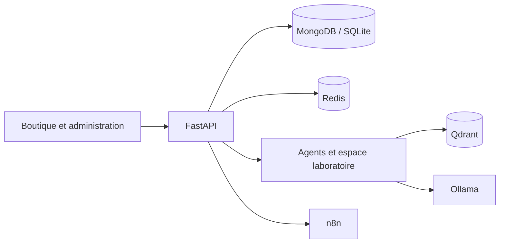

# Cosmetiques AI · Boutique & workflows IA

Une boutique de cosmétiques avec catalogue, back-office et agents IA pour explorer l'automatisation du commerce et l'accompagnement des équipes.

**FastAPI · React / Vinext · MongoDB · SQLite · Redis · Qdrant · Ollama · n8n**

## Fonctionnalités

- Catalogue et recherche, médias produit, packs et promotions.
- Panier, commande invitée et paiement à la livraison.
- Administration, support, rôles, suivi des commandes et historique des actions.
- Agents pour les contenus, le SEO, les recommandations, les analyses et l'assistance.
- Espace laboratoire : questionnaire, historique de conversation et génération de documents Word pour préparer le travail de formulation.

Les suggestions de formulation sont des supports de travail : elles nécessitent la validation d'un professionnel et les essais appropriés. Le projet ne constitue pas un système de validation de sécurité des produits.

## Architecture



Le projet reprend le socle d'[Ecommerce-AI](https://github.com/lahlouabdeslam6-rgb/Ecommerce-AI), puis ajoute ses parcours et services spécifiques. Son environnement Docker dispose de ports et de volumes distincts.

## Démarrage local

Prérequis : Git, Docker Desktop et Docker Compose. Les fonctions IA et multimédia utilisent des modèles et dépendances volumineux.

```powershell
git clone https://github.com/lahlouabdeslam6-rgb/CosmetiquesAI.git
cd CosmetiquesAI
Copy-Item .env.example .env
# Configurer les secrets locaux dans .env.
docker compose up -d --build
docker compose exec ollama ollama pull qwen2.5:3b
docker compose exec ollama ollama pull nomic-embed-text
# Modèle dédié au laboratoire, si cette fonction est utilisée :
docker compose exec ollama ollama pull qwen2.5:7b
```

| Service | Adresse locale par défaut |
| --- | --- |
| Boutique et gateway | http://localhost:5180 |
| Documentation API | http://localhost:8010/docs |
| Santé API | http://localhost:8010/health |
| n8n | http://localhost:5688 |

### Créer le premier administrateur

```powershell
docker compose cp scripts/bootstrap_admin.py backend:/tmp/bootstrap_admin.py
docker compose exec -e PYTHONPATH=/app backend python /tmp/bootstrap_admin.py
```

Le script demande un mot de passe neuf avec saisie masquée et refuse de créer un deuxième premier administrateur. Les variables des modèles sont configurables dans `.env.example`.

## Parcourir et vérifier

- `backend/app/` : API, logique métier et agents.
- `frontend/` : interfaces client et back-office.
- `scripts/` : initialisation et outils locaux.
- [Notes d'implémentation](docs/implementation-notes.md) : détails de configuration et historique technique. Les résultats de tests qui y figurent correspondent aux dates indiquées.

```powershell
docker compose run --rm --no-deps backend pytest -q
```

## État du projet

Prototype en évolution ; la marque est provisoire. Certains parcours et prompts proviennent du socle e-commerce et continuent d'être adaptés. Les simulations de paiement ne sont pas un paiement bancaire réel. Une démonstration locale ne remplace pas un déploiement permanent.

**Auteur : [Ismail Lahlou](https://github.com/lahlouabdeslam6-rgb)** · [Portfolio](https://portfolio-ismail-lahlou.alvarezvcarlosr44274.chatgpt.site/)
